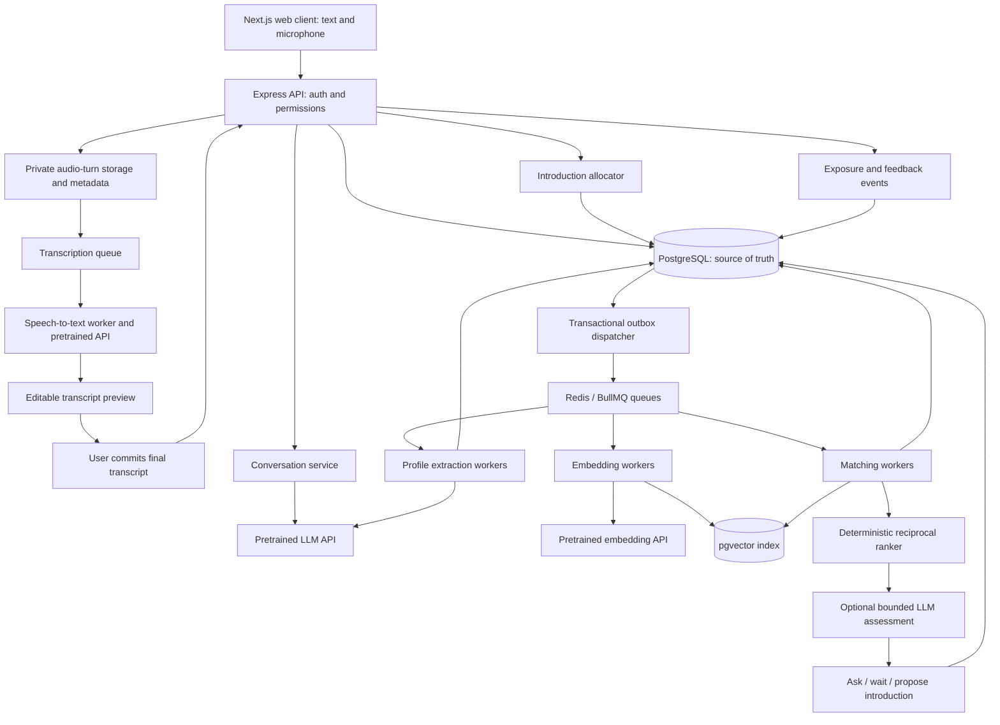

# Conversational matchmaking: system design and implementation blueprint

Status: proposed architecture and implementation plan. This document does not claim the application or benchmarks have been implemented.

## Product objective and assumptions

Help two consenting adults discover a mutually worthwhile introduction. Measure mutual acceptance first and voluntarily reported conversation quality and continued interest over time. Message volume alone is not success.

Support both typed messages and spoken answers from the first implementation. Speech-to-text is a required input capability; spoken assistant output is optional. Both input modes use the same evidence-backed profile and matching pipeline.

Assume periodic, curated introductions rather than an infinite swipe feed. A user may pause, set introduction frequency, or withdraw. Eligibility and capacity decisions apply to both people. The candidate graph need not be bipartite: orientation and preferences determine valid edges.

Separate three claims in the submission: implemented behavior, measured infrastructure performance, and hypotheses about real relationship outcomes. Synthetic profiles can validate constraints and workload behavior, but cannot establish relationship prediction accuracy.

## Architecture



Use one API deployable and one worker deployable initially. Workers can have separate queue consumers and concurrency limits without turning every module into a microservice. PostgreSQL remains authoritative; Redis is a queue/cache, not the authority for consent, blocks, or introduction capacity.

The current workspace already has Next.js, Express, Drizzle/PostgreSQL, and an OpenAI wrapper. Extend those rather than replacing them. Run BullMQ consumers in a Node.js worker container; verify shared package/runtime compatibility during implementation.

## Voice input and speech-to-text

Speech input is required alongside text. Implement push-to-talk or start/stop recording first: the user records an answer, reviews the transcript, edits if necessary, and sends it. This provides actual voice support without requiring continuous audio connections for the initial release. Live captions are a second transport mode feeding the same committed-message contract.

### Recorded voice turns: initial implementation

1. In the Next.js client, request microphone access only when the user activates recording, over HTTPS. Show recording state, elapsed duration, stop/cancel controls, and a typed alternative when permission is denied. Negotiate a supported browser recording format rather than assuming every browser records WebM.
2. Upload a bounded recording to an authenticated conversation-owned audio-turn endpoint with an idempotency key. Validate duration, file size, actual audio format, and ownership. Enforce application limits below provider limits; initial product limits could be 60 seconds and 10 MB per turn, subject to browser/encoding tests. Do not buffer unbounded recordings in the API process.
3. Store audio temporarily in private object storage with a short retention window and record a durable transcription job through the outbox. Return a turn ID and processing status. Signed URLs, if used, must be scoped, short-lived, and excluded from logs.
4. A transcription worker calls the pretrained provider. Keep the transcription model configurable; official OpenAI documentation currently recommends `gpt-transcribe` for completed recordings. Transcribe the original language rather than silently translating the user's statement. Evaluate any launch languages and code-switching explicitly before claiming support.
5. Store the provider's completed transcript as a draft. Show it in an editable preview with retry, discard, and send actions. Empty/silent or unsupported audio does not create a message or profile evidence. A provider-final transcript is not yet a user-submitted message.
6. On send, atomically create one canonical conversation message with `input_mode=voice`, the audio-turn ID, accepted transcript revision, and an idempotent commit key. Trigger the existing conversation response and profile extraction through the same path used by typed messages.
7. Delete raw audio once the accepted turn is committed, or when the draft expires/discards, unless the user has explicitly opted into a defined retention purpose. Retry jobs check deletion/account state and cannot resurrect expired audio. Keep the accepted text and necessary provenance under the conversation retention policy.

User edits remain authoritative. If an accepted transcript is corrected later, create a new message revision, supersede affected assertions, and refresh dependent profile/matching artifacts. Critical claims such as age, negations, intentions, or hard boundaries still require the usual confirmation policy; fluent transcription is not proof of correctness.

### Live transcription: production extension

When live captions are needed, add an authenticated session broker and a real-time audio transport. OpenAI documents WebRTC for browser audio and WebSocket for server-side pipelines; its current realtime transcription starting model is `gpt-live-transcribe`. Verify session/auth details against the deployed SDK and provider configuration before implementation, and keep permanent API keys server-side.

Display partial transcript events as provisional captions. Commit utterance boundaries using an explicit stop action or evaluated client-side voice activity detection. In the currently documented `gpt-live-transcribe` path, server/semantic VAD is not supported; do not assume it provides automatic turn detection. Order/reconcile final turns by session and turn IDs rather than arrival order, and retain the same editable-preview/commit contract.

A partial transcript must never become profile evidence. Reconnects and duplicate final events must not create duplicate messages. On disconnect, show an interrupted state and offer retry or text; do not switch transports while silently resending an already committed turn. Measure whether lower latency is worth additional connection, recovery, and quality complexity.

### Voice reliability, privacy, and scaling

- Keep transcription as a separate worker pool with independent provider limits, timeouts, bounded retries, queue-age monitoring, and per-user audio-minute budgets. Live sessions also need concurrent-session limits and idle/max-duration timeouts.
- Measure recording-end to final transcript, commit to first assistant response, error/correction rates, and transcription cost per audio minute separately from LLM token costs.
- Preserve meaningful wording and negations. Evaluate names, locations, accents, background noise, unsupported formats, silence, and declared multilingual/code-switching cases. Word error rate is useful, but preference/constraint error rate matters more for matchmaking.
- Do not infer attraction, personality, emotional stability, or compatibility from accent, pitch, or tone. Transcription feeds content into the profile pipeline; no voiceprint or voice-based compatibility scoring is proposed.
- Optional text-to-speech can read assistant replies later. It is separate from required speech-to-text and does not change ranking. If enabled, stop playback during user recording to avoid transcribing assistant audio.

## Data collected and representation

Collect information that changes eligibility, compatibility, or introduction timing, with clear purpose and optionality:

- Adult eligibility, city/coarse location, preferred age ranges, and who the user wants to meet.
- Relationship intentions, distance limits, relocation, children preferences where volunteered, and practical availability.
- Lifestyle, values, communication preferences, and illustrative stories.
- Desired partner attributes with importance and flexibility, separate from self-description.
- Confirmed boundaries, tentative preferences, uncertainty, and contradictory statements.
- What was offered, displayed, and accepted or declined, plus optional reasons and later outcomes.

Avoid inferring sensitive identities, diagnoses, attachment labels, or permanent traits from conversational style. Do not scrape private information. Raw conversations are private; public profiles and explanation-safe evidence are separate projections.

Each extracted assertion includes:

```ts
type Assertion = {
  userId: string;
  subject: "self" | "desired_partner";
  field: string;
  value: unknown; // Actual code uses a field-specific validated schema.
  evidenceMessageIds: string[];
  status: "explicit" | "inferred" | "contradicted" | "unknown";
  confirmedByUser: boolean;
  isHardConstraint: boolean;
  importance: number | null;
  observedAt: string;
  sourceConversationVersion: number;
};
```

Hard constraints require explicit user intent; the LLM cannot silently promote a weak preference into a boundary. Unknown does not mean false. Preserve conflicts and ask for resolution instead of overwriting inconvenient evidence.

Create separate, versioned embedding documents for self-description and desired-partner preferences. Start with these two; introduce dimension-specific representations only if retrieval evaluation justifies them. Record embedding model/version and dimensions. Model changes require a separate index/backfill and measured cutover; do not mix incompatible vectors.

## Database tables

| Table                     | Essential contents                                                                                        |
| ------------------------- | --------------------------------------------------------------------------------------------------------- |
| users                     | Auth identity, account state, adult eligibility                                                           |
| conversation_messages     | User ownership, role, content/revision, sequence, input mode, audio-turn link, timestamp                  |
| audio_turns               | Conversation ownership, private object key, duration, format, retention deadline, processing/commit state |
| transcript_revisions      | Audio-turn ID, provider/model, draft text, accepted correction, revision, canonical message link          |
| profile_assertions        | Values, evidence links, explicitness, confirmation, history                                               |
| profile_versions          | Immutable normalized profile snapshots and revisions                                                      |
| profile_constraints       | Typed queryable mutual eligibility fields                                                                 |
| profile_embeddings        | User/version/kind/model/dimensions/vector                                                                 |
| preference_state          | Versioned soft preferences and supporting feedback                                                        |
| blocks                    | Directed block edges; eligibility rejects either direction                                                |
| matching_runs             | Input versions, policy/prompt versions, status, timings, usage                                            |
| candidate_evaluations     | Bounded shortlist, directional feature results, unknowns                                                  |
| introductions             | Canonical pair, lifecycle, expiry, consent decisions                                                      |
| introduction_reservations | Active per-user capacity reservations                                                                     |
| exposure_events           | Selected, displayed, viewed events with position and policy                                               |
| feedback_events           | Explicit reason, outcome, timestamp, attribution                                                          |
| outbox                    | Durable work requested in the same transaction as state changes                                           |
| usage_events              | Tokens, provider request identifiers, latency, estimated cost                                             |

Use typed columns for queryable eligibility; JSONB is suitable for nuanced structured evidence. Index ownership, pair lookup, active account state, eligible scalar ranges, and geo queries as measured. Use a canonical pair key to prevent duplicate active introductions regardless of who triggered the run.

## Flow 1: conversation to confirmed profile

1. Authenticate and authorize the conversation owner. Typed messages are submitted directly; voice transcripts enter this flow only after finalization and user send. Persist each canonical message with an idempotency key and input provenance.
2. Stream the conversational response. Provide only the relevant user's context and pending questions.
3. Coalesce extraction work at meaningful conversation boundaries rather than extracting the whole history on every token/message.
4. Extract a proposed profile patch using a schema-constrained LLM response. Validate field types, evidence ownership, enum values, and boundary rules. Handle refusal, truncation, and provider failure explicitly.
5. Store assertions and evidence. Ask the user to confirm consequential interpretations and resolve contradictions.
6. Commit a new profile version plus an outbox event in one PostgreSQL transaction.
7. Workers create embeddings from confirmed/allowed profile projections and mark the new version ready.

A worker must not overwrite a newer profile with an older job result. Use expected-version checks and retry/reconcile after conflicts. Treat conversational content as data: it cannot change system instructions, query other users' messages, or authorize database actions.

## Flow 2: candidate retrieval

Never enumerate every pair. With one million accounts there are about 500 billion unordered pairs.

For an active, available user A:

1. Establish coarse mutual eligibility: active adults, compatible intentions, orientation/preferences, age ranges, location bounds, and no block in either direction.
2. Retrieve a union of semantic, structured, and exploratory candidates. A reasonable initial experiment is up to 1,000 unique IDs total; this is a tuning parameter, not a quality or latency guarantee.
3. Semantic retrieval compares A's desired-partner document with candidate self-descriptions. This only proposes candidates; generic embeddings do not prove preference satisfaction or reciprocal interest.
4. Structured retrieval supplies complementary candidates that semantic similarity could miss. Exploration stays inside eligibility boundaries.
5. Deduplicate and apply exact mutual constraints. Unknown critical eligibility routes to clarification or deferral, never an assumed pass.

Selective filters can undermine approximate-nearest-neighbor recall. Benchmark pgvector iterative scans, scalar-filtered exact search for small eligible pools, and overlapping geographic partitions when justified. Location boundaries and relocation preferences must not disappear at partition edges. Recheck exact eligibility downstream even when retrieval applied filters.

Evaluate two different failures: ANN missed nearest eligible vectors, versus the representation missed good people. Exact-vector recall measures the first; labelled candidate-pair evaluation and later outcomes address the second.

## Flow 3: reciprocal ranking without custom model training

Evaluate preferences against attributes, not just self-profile similarity:

```text
A's desired partner preferences -> B's attributes
B's desired partner preferences -> A's attributes
```

The first ranker is an inspectable TypeScript module. For each direction, evaluate goals, practical compatibility, lifestyle, and values using explicit field-specific rubrics. Keep unknowns distinct from agreement or disagreement. User importance weights are explicit when available; documented defaults are initial product assumptions.

One baseline:

```text
directional_score = sum(weight_i * compatibility_i) / sum(known weight_i)
coverage = sum(known weight_i) / sum(applicable weight_i)
pair_score = sqrt(score_A_to_B * score_B_to_A)
```

Return no score when the known-weight denominator is zero. Coverage is evidence coverage, not statistical confidence. A high score supported by one hobby cannot automatically outrank a thoroughly evaluated pair: minimum critical evidence rules and follow-up policy govern introduction eligibility. Inapplicable dimensions should be excluded from both denominators.

Recheck hard constraints before ranking and before delivery. A score cannot compensate for a violated hard boundary.

Retain roughly the top 100 inexpensive evaluations for further policy checks. Optionally send at most five promising, eligible pairs to a bounded LLM rubric assessment to examine nuance, cite approved evidence IDs, and flag tensions/unknowns. Compare this optional step against the deterministic baseline before relying on it. Avoid unbounded agent-to-agent conversations or invented simulations of how users would react.

Prefer separate LLM assessment fields over silently replacing the score. Start with deterministic or structured-template explanations, optionally using the LLM for wording. Explanations may refer only to information approved for sharing; private supporting messages stay private.

All scores remain heuristics until validated against real outcomes. Do not show percentages of relationship success or label an LLM's self-reported confidence as calibrated.

## Flow 4: introduce, ask, or wait

The policy considers critical missing fields, evidence conflicts, supported compatibility, account availability, and introduction budget.

- Ask a focused question if an unresolved preference could materially alter the decision, such as distance or children intentions.
- Offer an introduction when eligibility is established and supported compatibility clears the current policy.
- Explore a limited number of uncertain but eligible candidates, with monitoring, so sparse/new profiles are not permanently excluded.
- Wait or abstain when evidence is too weak, account state is stale, or capacity is unavailable.

Choose follow-ups by which unresolved field could change a boundary or ordering, rather than claiming exact expected information gain without a probabilistic model. Budget questions so users are not interrogated indefinitely.

Both users must opt into the introduction flow. Acceptance is not automatic relationship assignment. Contact details require the intended consent transition.

## Flow 5: allocate scarce attention safely

Independent top-k lists can overload the same people. Initially, use a capacity-aware greedy allocator over eligible candidate edges, with a cap per person and configurable exposure constraints. This is inspectable but not globally optimal; compare with more sophisticated graph allocation only when measurements justify it.

For each selected edge:

1. Begin a PostgreSQL transaction and lock both users' capacity rows in canonical ID order.
2. Recheck current boundaries, blocks, pause/deletion state, introduction count, input freshness, and duplicate-pair state.
3. Reserve capacity for both users and create the pending introduction atomically.
4. Record notification work in the transaction's outbox.
5. Release reservations on decline, expiry, or cancellation with idempotent transitions.

The last eligibility check is against authoritative state, not Redis. A concurrent block/withdrawal must be synchronized with allocation state transitions so a stale worker cannot create an introduction after the block/withdrawal commits. Recheck before exposing sensitive information; cancel undelivered pending introductions when boundaries change.

## Flow 6: feedback without overreaction

Explicit profile corrections and confirmed boundaries update immediately. A pair decline excludes that pair from immediate repetition, but does not automatically become a global preference.

For inferred soft-preference updates, use a bounded, versioned policy: collect attributable reasons, require repeated independent evidence before strengthening a hypothesis, cap each event's influence, and expose proposed consequential changes for confirmation. This is a cautious rule-based adaptation policy, not a calibrated learned model. Test the thresholds and inspect failures.

Silence, lack of display, timing, and rejected incompatibility are different events. Store delayed outcome windows rather than assigning instant negatives to everyone who has not replied.

Record selection policy and probability for randomized exploration where known. Future causal/off-policy evaluation needs justified propensities and adequate support; logging a score does not itself eliminate exposure bias.

## Job reliability, cache behavior, and failures

- Use PostgreSQL transactional outbox plus an idempotent dispatcher. A database write cannot silently succeed while its work request is lost.
- Use at-least-once queue delivery, stable job keys, retry with exponential backoff/jitter, provider-aware concurrency limits, and dead-letter inspection. Deduplication reduces repeated work but does not establish exactly-once business behavior.
- Key embedding and matching outputs by profile versions and policy/model versions. Reject stale publication using conditional database updates.
- Cache only a bounded shortlist for active users; include both input profile versions in pair artifacts. Refresh active users with a TTL and material-change events rather than recomputing the entire graph after every edit.
- Safety/eligibility edits invalidate pending results immediately; softer edits may refresh asynchronously within a documented staleness window. Avoid global reverse-candidate fanout; authoritative delivery checks protect constraints.
- On LLM failure, keep the last confirmed profile and mark processing pending. Deterministic ranking/explanation can continue on valid inputs. Do not fall back by inventing missing facts.
- On retrieval failure, use a bounded structured eligible pool where available, or defer. Never silently relax dealbreakers.
- Track queue depth, oldest-job age, provider errors, retrieval recall, latency, cost, and introduction conflicts. Track transcription failures, audio minutes, draft age, correction rate, and live connection limits separately. Audio upload and transcription retries must not duplicate committed messages.

## Scaling assumptions and capacity calculation

Illustrative planning scenario, not a measured capacity claim:

- 1 million registered accounts, 50,000 daily active users.
- 200,000 messages/day: about 2.3 requests/second averaged across a day, but size for measured peaks and concurrent streams.
- 5,000 material profile changes/day after coalescing: approximately 10,000 embedding documents/day with two embeddings/profile.
- If every change triggers one 1,000-candidate refresh: approximately 5 million inexpensive pair evaluations/day. Periodic refreshes for unchanged active users add to this budget and must be counted separately.
- Optional five-pair LLM assessment: up to 25,000 pair assessments across these change-triggered refreshes, potentially batched into 5,000 requests. Disable/cap this until quality benefit is demonstrated.
- Illustrative voice budget: if 50,000 turns/day average 30 seconds, transcription processes 25,000 audio minutes/day. Add transcript handling to the message budget rather than counting a voice turn and its canonical message as two user messages. Plan storage from encoded bitrate and retention; live sessions add a separate peak-concurrency budget.
- Keep at most 20 cached candidate edges per 50,000 active users: about 1 million compact directional references, not a billion-edge permanent graph.

For float32 embeddings, raw payload is approximately `users * representations * dimensions * 4` bytes before row/index overhead. At one million users, two 1,536-dimensional vectors are about 12.3 GB of raw values; HNSW index, database storage, replicas, and working memory add substantially. Dimensions are an example, not a selected model contract.

Estimate daily AI cost from measured tokens/embeddings and the provider's verified current rates, separating conversation, extraction, optional assessment, and retries. A user count alone cannot establish latency or cost. Benchmark representative filter selectivity, active-pool density, update churn, and burst load.

Scale stateless API instances and worker consumers independently. Cap workers to protect database connections and provider limits; raising concurrency blindly can worsen latency. Use database pooling, measure query plans, and consider search isolation or partitioning only after identifying bottlenecks.

## Privacy and access controls

Authenticate ownership on every user-facing route. Matching workers receive narrowly scoped internal access; the conversational assistant has no arbitrary cross-user SQL tool. Prompt input is untrusted. Explanations use a separate shareable profile projection and approved evidence snippets, not raw private chat.

Keep API keys server-side, minimize logs, restrict internal review tools, and define retention. Voice requires explicit recording controls, private temporary audio storage, expiring access, and raw-audio deletion. Deletion covers unfinished audio turns, transcript drafts, transcription jobs, and any active voice sessions as well as text data. Deletion covers profile projections, embeddings, caches, pending introductions, and queued work; workers must check account state before writing. Retained backups follow an explicit expiry/access policy. If training is introduced later, document data eligibility, deletion handling, and model lineage separately.

## Implementation layout

```text
apps/client/                   Existing Next.js UI
  ... onboarding, microphone recorder, transcript preview, profile review, introductions, feedback
apps/server/src/
  matchmaking/                Authorized routes and orchestration
  voice/                      Uploads, transcription state, transcript commits, future live sessions
  profiles/                   Versioned profiles and confirmations
  introductions/              Consent, capacity and lifecycle
  feedback/                   Events and cautious preference updates
apps/worker/                  Proposed Node.js queue consumers, including transcription
packages/db/                  Drizzle schema and migrations
packages/llm/                 Provider adapter, schemas, usage accounting
packages/matching/            Proposed pure TypeScript matching logic
  eligibility.ts
  features.ts
  score.ts
  uncertainty.ts
  allocation.ts
  explanations.ts
evals/matchmaking/             Behaviour cases and retrieval benchmarks
```

Suggested endpoints:

```text
POST  /conversations/:id/messages
POST  /conversations/:id/audio-turns        Upload and enqueue; returns 202 + turn ID
GET   /conversations/:id/audio-turns/:turnId
POST  /conversations/:id/audio-turns/:turnId/commit
DELETE /conversations/:id/audio-turns/:turnId
POST  /conversations/:id/voice-sessions     Future live-mode session broker
GET   /me/profile
PATCH /me/profile                Explicit corrections/confirmations
POST  /me/matching-runs          Async; returns run ID
GET   /me/matching-runs/:id
GET   /me/introductions
POST  /introductions/:id/decision
POST  /introductions/:id/feedback
POST  /me/blocks
POST  /me/pause
DELETE /me
```

All `me` ownership is derived from the authenticated session. Introduction endpoints verify participation. Debug traces need separate authorization and should redact other users' private data. Mutation endpoints carry idempotency keys where repeated requests could create duplicate work.

Matching-worker pseudocode:

```ts
async function refreshCandidates(userId: string, expectedVersion: number) {
  const a = await profiles.readReady(userId, expectedVersion);
  if (!a || !a.available) return;

  const candidates = await retrieval.union(a, { totalBudget: 1000 });
  const pendingEligibility = [];
  const evaluated = candidates.flatMap((b) => {
    const eligibility = checkMutualEligibility(a, b);
    if (eligibility.kind === "unknown") {
      pendingEligibility.push({ candidateId: b.userId, eligibility });
    }
    if (eligibility.kind !== "pass") return [];
    return [evaluateBothDirections(a, b)];
  });

  const shortlist = rankWithEvidencePolicy(evaluated).slice(0, 100);
  const assessment = await optionalBudgetedAssessment(shortlist.slice(0, 5));
  const proposals = chooseActions(shortlist, assessment, pendingEligibility);

  // Publish only if profile/policy versions are still current.
  // This stores proposals, not permission to expose an introduction.
  await runs.publishIfCurrent(userId, expectedVersion, proposals);
}

// Actual introduction delivery separately rechecks both users and
// reserves capacity in a PostgreSQL transaction.
```

## Implementation milestones

1. Define profile schemas, eligibility rules, evaluation cases, and outcome definitions before prompt tuning.
2. Implement auth/ownership, private text conversations, and required recorded speech input: microphone UI, private uploads, transcription worker, editable preview, and idempotent transcript commits. Then add evidence-backed extraction, profile review, and versioned corrections. Live captions extend the same contract after the recorded path is validated.
3. Implement the pure TypeScript reciprocal baseline and exact retrieval to establish a correctness reference.
4. Add pgvector candidate retrieval and compare it against exact retrieval under realistic filters.
5. Add outbox/queues, version checks, bounded LLM assessment behind a feature flag, and usage accounting.
6. Implement introduction consent/capacity transactions, pause/block/delete behavior, and feedback updates.
7. Load-test, evaluate, deploy, and publish the measured results and unresolved limitations.

## Evaluation and deployment

Evaluate extraction against human-reviewed conversations: explicit facts, evidence support, contradiction handling, and unsupported-inference rate. Evaluate hard constraints with meaningful examples and invariants in both directions. Test zero evidence, complementary preferences, model refusal, stale jobs, duplicates, simultaneous allocations, and boundary changes during processing.

For speech input, test microphone permission denial, browser audio format differences, silence/noise, interrupted uploads, provider timeouts, duplicate commits, draft discard/expiry, and raw-audio deletion. Test negation and number errors affecting constraints, and verify no partial or unsubmitted transcript updates a profile. Measure semantic/constraint accuracy alongside transcription error and latency; evaluate each language/accent slice claimed by the product.

Measure retrieval eligible recall@K against exact vector search and separate semantic-relevance judgements. Measure optional LLM ranking consistency, evidence support, added latency/cost, and benefit over the baseline. Evaluate shortlist quality on independently labelled cases; synthetic labels do not validate real outcomes.

For real users, measure mutual acceptance per delivered eligible introduction, optional quality/continued-interest feedback, unwanted-introduction reports, and opportunity distribution. Respect delayed labels. Future trained-model evaluation should use temporal splits, profile snapshots available at the prediction time, and explicit cold-start slices. Online experiments may affect both sides of the network; independent user randomization can create interference, so choose a network-aware experiment design before making causal claims.

Host the web client separately from the long-running API/worker containers. Use managed PostgreSQL with pgvector and managed Redis, secret storage, health checks, backups, and migrations. Keep the first deploy simple; infrastructure scale claims require representative benchmarks.

## Tradeoffs to defend

| Decision                         | Benefit                                                                | Cost / limitation                                                                               |
| -------------------------------- | ---------------------------------------------------------------------- | ----------------------------------------------------------------------------------------------- |
| Recorded speech-to-text first    | Voice support with bounded, recoverable turns and editable transcripts | Slower than live captions; live sessions add connection, turn-boundary, and recovery complexity |
| Pretrained LLM extraction        | Rich conversational understanding without own-model training           | Misinterpretations; require evidence validation and user correction                             |
| Hybrid candidate retrieval       | Bounded work and complementary candidate sources                       | Recall loss; measure representation quality and filtered ANN recall separately                  |
| Explicit reciprocal baseline     | Inspectable and inexpensive                                            | Initial weights are assumptions, not learned outcome probabilities                              |
| Optional small LLM assessment    | Can examine nuance                                                     | Cost, variability, and weak calibration; retain only with measured benefit                      |
| Background computation           | Lower request latency and controlled provider spending                 | Eventual freshness; versions, invalidation, and final authoritative checks                      |
| Conservative feedback            | Limits overreaction                                                    | Slower adaptation; strong explicit corrections update immediately                               |
| Capacity-aware greedy allocation | Practical attention management                                         | Not globally optimal; benchmark alternatives if necessary                                       |
| No custom model initially        | Honest use of available evidence                                       | Outcome prediction remains unproven until sufficient real feedback exists                       |

## Where custom ML could enter later

A learned ranker is a later experiment when real, consented, attributable outcomes exist. Compare it to the baseline on mutual interest and quality; do not train on the system's own guesses as ground truth. Learned retrieval can follow if candidate recall is the measured bottleneck. LLM fine-tuning is a separate decision for persistent extraction or format failures after prompting/schema improvements; it does not itself establish romantic compatibility.

## Primary references

- [OpenAI transcription overview](https://developers.openai.com/api/docs/guides/transcription), [file transcription](https://developers.openai.com/api/docs/guides/speech-to-text), and [realtime transcription](https://developers.openai.com/api/docs/guides/realtime-transcription): distinct recorded/live workflows and transcript finalization. Model guidance checked on 13 October 2026; verify deployment access and SDK support.
- [OpenAI Structured Outputs](https://developers.openai.com/api/docs/guides/structured-outputs): schema-constrained model outputs; semantic correctness still needs evaluation.
- [pgvector](https://github.com/pgvector/pgvector): vector search, filtered approximate-search behavior, and iterative scans.
- [BullMQ deduplication](https://docs.bullmq.io/guide/jobs/deduplication) and [retry behavior](https://docs.bullmq.io/guide/retrying-failing-jobs): queue mechanisms; business idempotency remains application responsibility.
- [A Reciprocal Embedding Framework for Modelling Mutual Preferences](https://ojs.aaai.org/index.php/AAAI/article/view/17807): reciprocal recommendation research.
- [Recommendations as Treatments](https://proceedings.mlr.press/v48/schnabel16.html): selection bias in recommendation learning and evaluation.
- [Fair Reciprocal Recommendation in Matching Markets](https://arxiv.org/abs/2409.00720): tradeoffs between matching outcomes and opportunities.
